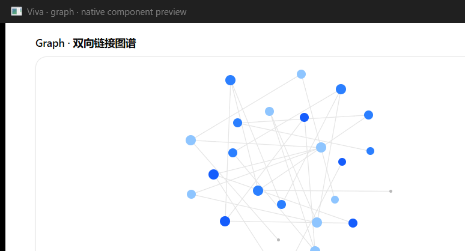
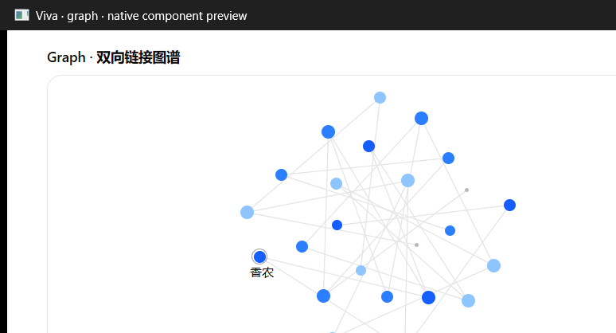

# Graph 组件调研报告：类 Obsidian 双向链图

> 本报告的落地成果已合入 `components` 包：`GraphSim`（d3-force 模型的布局模拟）与
> `PaintGraph`（绘制组件），配套 `internal/componentdemo` 的 vault / local 两个示例。
> 下图即 `component-preview -component graph -example vault` 的实际运行截图。





调研日期：2026-11-13。方法：本地代码研究（viva 组件契约、渲染/交互/动画能力）+ 四路并行网络调研（Web 可视化库、笔记应用图谱视图、力导向布局算法、原生 GUI 与 Go 生态），约 60 个来源，关键论断均有交叉验证；无法核实的声明在文中标注〔未证实〕。

---

## 1. 结论速览

1. **布局引擎自研，组件只负责画。** 行业共识是布局与渲染彻底解耦：布局是纯函数 `(nodes, links) → x/y`，渲染器只读坐标。Go 生态没有可用的力导向模拟库（详见 §3.4），需要自己写——但 d3-force 的参考实现实测只有 **693 行 JS**，Go 移植量约一天核心 + 打磨。
2. **两大标杆殊途同归。** Obsidian 与 Logseq（最大的两个本地笔记应用）当前都是 **d3-force 模拟 + GPU 渲染（PixiJS/WebGL）**，模拟与渲染跑在不同线程。Logseq 的 package.json 直接依赖 `d3-force@3.0.0` 与 `pixi.js@^8.18.1`（已核实）；Obsidian 为 d3-force 跑在 Web Worker（社区逆向协议证实）。
3. **交互的核心三件套**：hover 高亮节点+邻居并压暗其余、节点尺寸 ∝ 链接数（度数）、过滤器 + 按查询着色的分组。这是所有产品收敛出的最小可用集。
4. **「局部图」才是用户真正常用的视图。** 全球图被用户称为「屏保」；写作时挂在侧栏的深度受限局部图（当前笔记的 N 跳邻域）才是日常工具。API 应从第一天就围绕「作用域」设计，而不是只做一个全局图。
5. **性能瓶颈在标签和像素，不在边数。** sigma.js 实测大图帧是 fragment-bound（填充率受限）：关边抗锯齿可提速 5 倍、标签网格去重只画放得下的、视口剔除。节点力计算用 Barnes-Hut 四叉树（O(n log n)）覆盖到 5 万节点无压力。
6. **确定性可测是免费的。** d3 用固定种子 LCG + 螺旋初始布局 + 数组顺序遍历做到 bit 级可复现；Go 移植要避开 map 迭代随机序这一个坑，就能做金测（golden hash）。

---

## 2. viva 的约束与已有能力（本地代码研究）

graph 组件必须落在 viva 的组件契约内（[components/doc.go](../components/doc.go)）：

| 契约 | 对 graph 组件的含义 |
|---|---|
| 无状态 `Paint*` / `Begin*` 链式声明，应用拥有全部状态 | 位置/速度/alpha/视口/选中态全部 caller-owned；组件仿照 `ChartState` 提供 `GraphState`（含稳定绘制零分配的缓存） |
| 无隐藏 worker/goroutine、无定时器 | 力模拟不能自己起线程；tick 由绘制循环或应用驱动，「渲染驱动模拟」（force-graph 的模式）最自然 |
| hit ID 显式字面量、跨绘制稳定 | 每个可见节点注册 `canvas.Hit(id, bounds)`，ID 由节点索引派生、稳定 |
| 语义可访问性内建 | 键盘在邻居间移动（仿 `ChartStepForKey`）、焦点环、语义声明 |
| `viva add <name>` 安装模板 | 新增组件要过完整安装面：`components/*.go` → `tools/componentgen` 生成 `cmd/viva/templates/*.go.txt` + `components_gen.go` 注册 + `internal/componentdemo` 演示 + website 文档 |

已有能力（不需要新造）：

- **矢量路径**：`gfx.PathBuilder`（MoveTo/LineTo/QuadTo/CubicTo）+ `DrawPath`（描边/填充/caps/joins）——画边和节点圆足够；无 ArcTo，圆用 4 段三次贝塞尔近似（kappa 常数）。
- **动画时钟**：`gfx.Motion` + canvas clock + `settled()` 检测——模拟「冷却到静止 → 零 CPU」正好挂在这套机制上（caret blink / overlay 淡入淡出同款）。
- **zoom/pan 先例**：`PaintImageView` 的 caller-owned `Zoom`/pan 状态。
- **instanced 渲染**：后端已是 instanced 矩形管线；节点=一批 instanced 圆、边=一批线段，天然对齐 sigma.js v4 的架构。
- **Web 目标**：viva 同时编译 WebAssembly/Canvas2D；组件层只准走 `gfx.Canvas` 抽象，模拟在 wasm 里跑没有问题——**不能假设 WebGL-only**。

---

## 3. 全景图：市面上的 graph 相关组件

### 3.1 Web 可视化库（星数为 2026-11-13 GitHub API 实取）

| 库 | 星数 / 许可 | 渲染 | API 形态 | 布局 | 一句话特点 |
|---|---|---|---|---|---|
| [sigma.js](https://github.com/jacomyal/sigma.js) v3/v4 | 12,239 / MIT | WebGL，v4 SDF + 数据纹理 | graphology 图模型，渲染器只读 x/y | 完全解耦（graphology 布局包，常跑 Worker） | 大图渲染标杆；v4 单 pass 任意形状 + 命名图层 |
| [cytoscape.js](https://github.com/cytoscape/cytoscape.js) | 11,286 / MIT | Canvas2D（有 WebGL 模式） | elements JSON + **选择器样式表**（CSS 式，`mapData` 数据映射） | 插件生态（cose/fcose/cola/spread），可 headless | 声明式样式系统最完整；Canvas 天花板 |
| [antvis/G6](https://github.com/antvis/G6) v5 | 12,390 / MIT | AntV G 引擎，Canvas/SVG/WebGL 按层可换 | 声明式配置：behaviors/plugins 列表 | 内置最丰富（force/FA2/radial/dagre…），Worker 运行时 | 分析型全家桶；**行为即配置**的典范 |
| [force-graph](https://github.com/vasturiano/force-graph)（+3d/react 变体） | 2,169 / MIT | Canvas2D | **accessor 函数**（nodeVal/nodeColor/linkColor…）+ 自绘逃生舱 `nodeCanvasObject` | d3-force 内嵌，渲染循环每帧 `tick()` | 「拿来即用的 Obsidian 图」事实标准 |
| [vis-network](https://github.com/visjs/vis-network) | 3,640 / Apache-2.0 | Canvas2D | DataSet + 大 options 对象 | 内置物理（BH 等 4 种求解器）+ **稳定阶段**（stabilization） | 电池全含（聚类/导航按钮/操作 UI）；配置臃肿是反面教材 |
| [d3-force](https://github.com/d3/d3-force) | 2,013 / ISC | 无（纯布局） | `forceSimulation(nodes)` + 可组合力 | 它就是布局本身 | 事实标准内核；Obsidian/force-graph/无数应用的心脏 |
| [xyflow](https://github.com/xyflow/xyflow) | 38,991 / MIT | DOM+SVG 混合 | nodes/edges 数组 + 组件注册 | 无（外部接 dagre/d3-force） | 节点编辑器（非力导向）；交互 UX 黄金标准：minimap、框选、虚拟化剔除 |
| [ECharts](https://github.com/apache/echarts) graph 系列 | 67,711 / Apache-2.0 | zrender Canvas/SVG | 声明式 option JSON | force(BH)/circular/none | `focus:'adjacency'` 一行实现邻域聚焦 |
| [reagraph](https://github.com/reaviz/reagraph) | 1,101 / Apache-2.0 | three.js/WebGL | nodes/edges 数组 | 15+ 可插拔布局 | PageRank/中心性自动定节点尺寸；套索选区；路径查找 |

### 3.2 笔记/知识管理应用的图谱视图（UX 标杆群）

| 应用 | 全局/局部 | 过滤 | 分组/颜色 | 节点尺寸 | hover | 点击导航 |
|---|---|---|---|---|---|---|
| **Obsidian** | 都有；局部图 = 全部设置 + 深度滑杆 | 搜索查询、标签、附件、仅存在文件、孤儿 | 用户定义「组」= 搜索查询 + 颜色（含正则） | ∝ 入链数 | 高亮邻居、压暗其余、浮现标签 | 单击打开笔记；右键完整菜单 |
| **Logseq** | 都有 | 页面图可排除 | — | — | force-graph 式默认 | — |
| **思源 SiYuan** | 都有（局部到块级粒度） | 块类型过滤 | 节点用笔记颜色/图标 | — | — | **Ctrl+点击**跳转 |
| **Roam Research** | 都有（局部 = Alt+Shift 点引用） | 直连开关、隐藏未连接页 | — | — | — | 单击跳转；有 3D 模式 |
| **Trilium** | 自动 Link map + 手动 Relation map | 深度滑杆、标签配置 | 节点用笔记颜色/图标，5 种边类型 | — | 高亮相邻 | 单击打开；关系图本身可编辑 |
| **Foam (VSCode)** | 一个全局图，自动居中当前笔记 | 按 frontmatter type | 按类型着色 | ∝ 连接数 | 高亮连接 | **Ctrl/Cmd 点击**打开，单击=选中 |

### 3.3 桌面原生 widget

- **[egui_graphs](https://github.com/blitzarx1/egui_graphs)**（Rust/egui，714★，MIT，作者已宣布不再积极维护=可放心移植）：`GraphView` widget 包裹 petgraph；力布局每 UI pass 步进一次；返回 `(response, Vec<Change>)` 每帧有序事件列表；光标锚定缩放、拖拽增量÷zoom、fit-to-view、选中/拖拽元素**延迟到前景层**绘制。弱点：无剔除、无 LOD（CPU 曲面化假设）——恰好是 viva 该超越的点。
- **Gephi**（Java/JOGL）：布局是插件（ForceAtlas2 自带线程池，≥1000 节点默认开 Barnes-Hut）；渲染缓冲增量更新；**圆按屏幕像素 LOD**（128/16/2px → 64/32/16/8 顶点）；**字形图集缓存 + LRU**；标签网格避让。
- **yEd / Cytoscape 桌面版**：框选（marquee）、放大镜、minimap 鸟瞰窗；布局是**用户显式触发的菜单操作**（可只作用于选中子图）。

### 3.4 Go 生态（结论：无可复用的模拟库）

| 库 | 状态 | 结论 |
|---|---|---|
| [loov/layout](https://github.com/loov/layout) | 32★，活跃但年轻 | 批量布局出坐标，不是可步进交互模拟；可当初始位置种子源 |
| [gverger/go-graph-layout](https://github.com/gverger/go-graph-layout) | 98★，2025 停滞 | 弹簧力数学的移植参考 |
| [goccy/go-graphviz](https://github.com/goccy/go-graphviz) | 834★ | Graphviz 绑定，一次性离线布局；拖 Graphviz 进来不适合实时 GPU widget |
| [gonum/gonum](https://github.com/gonum/gonum) | 8,461★ 活跃 | 图数据结构/路径/社区发现，**无布局** |
| 其他（unraveler BH 实现、FR 小实现等） | 死/微型 | 算法参考；`forceatlas2 language:go` 搜索结果为零 |

**判定：布局引擎自研**（d3-force 模型，核心约 700 行参考实现），依赖零新增。

---

## 4. 重点对象的设计分析

### 4.1 Obsidian 图谱视图（UX 标杆 + 逆向实现）

**用户体验设计**（官方文档）：
- 节点=笔记、边=链接，**入链越多节点越大**（度数尺寸是一等公民）。
- 过滤面板：搜索查询（完整搜索语法）、标签开关、附件开关、仅存在文件（隐藏未解析的占位链接）、孤儿开关。
- **颜色组**：每「组」= 一条搜索查询 + 一个颜色，查询可达标签/文件夹/正则。
- 显示项：箭头开关、**文字淡出阈值**（缩小时标签淡出）、节点尺寸、连线粗细、时间轴动画（按创建时间回放）。
- 力参数直接暴露为四个滑杆：中心力、斥力、链力、链距离——把物理模型交给用户调。
- **局部图**：继承全局全部设置 + 深度滑杆（每层深度展示上一层新揭示节点的连接）。

**内部实现**（社区逆向，〔PixiJS/WebGL 一节未获官方证实〕）：d3-force 跑在 **Web Worker**，节点状态 `{id, x, y, vx, vy, fx, fy}`，worker 回传 `id → [x,y]` 位置表；参数与 d3 默认几乎一致（link distance 30、manyBody ≈ -30、`alphaMin=0.001`、约 300 tick、`velocityDecay=0.4`、螺旋初始布局）；渲染已迁移 WebGL。第三方插件（Juggl）用 Cytoscape 做全局图，官方文档自己警告「大库会冻住 Obsidian」——渲染栈选错的真实代价。

### 4.2 d3-force（布局内核的事实标准）

不是单一算法，是**小内核 + 可组合力**：velocity-Verlet 积分（单位时间步、单位质量），力是可替换的闭包。每 tick：`alpha += (alphaTarget - alpha) × alphaDecay` → 各力更新速度（按 alpha 缩放）→ `v ×= (1 - velocityDecay)` → `x += v`。默认 alpha 从 1 指数衰减到 alphaMin=0.001（decay=0.0228），**约 300 tick 后自然停止 → 零 CPU**。拖拽/数据变更 `restart()` 把 alphaTarget 设 0.3 回温。

关键设计值得整段照抄：
- **确定性**：默认 RNG 是 9 行固定种子 LCG；未初始化节点按**向日葵螺旋**摆放（确定性均匀覆盖）；v4 明确「精心避免非确定性」。
- **fx/fy 钉住协议**：tick 末 `x=fx, vx=0`。拖拽 = 设 fx/fy，松手清除（Obsidian 同款）。
- 内置力：link（弹簧+每节点偏置）、manyBody（**Barnes-Hut 四叉树，theta 0.9**）、center、collide、x/y/radial。实测源码 693 行。
- 增量更新模式：数据变更时保留旧位置（按 key 映射）、新节点放到邻居质心附近、reheat——新笔记从上下文里「长出来」而不是从天而降。

### 4.3 sigma.js v3/v4（GPU 渲染架构的最近亲）

「graphology 计算，sigma 绘制」的干净分层赢了 Cytoscape 的大规模市场（Microsoft Fabric、GitLab KG、BloodHound 在用；npm 周下载 ~25 万）。v3：每元素类型一个 WebGL program、**instanced 渲染 + GPU picking**、标签网格去重、标签尺寸 LOD 阈值。v4（2026-10 发布）更激进一步：**SDF 描述形状**单 pass 画任意节点形状、**全部元素数据平铺进 GPU 数据纹理**、SDF 烘焙字体标签（告别 Canvas 文本）、**命名图层 + zIndex**（hover/选中节点挪到顶层「几乎免费」）、原生平行边与自环，甚至实验 GPU ForceAtlas2 直读 GPU 纹理。

对 viva 的映射：viva 的 retained scene + instanced 矩形管线和 sigma v4 的形状同构——「基础层/高亮层」两个层、hover 是换层不是重排；标签用网格去重只画放得下的；**性能指南实测大图是 fragment-bound**（减半顶点只省 6% 帧时；关边抗锯齿提速最高 5 倍；半透明混合昂贵，压暗请用接近背景的实色而不是 alpha）。

### 4.4 vasturiano/force-graph（组件 API 设计范本）

- **accessor 函数 API**：`nodeVal/nodeColor/linkColor/...` 每一项都是「常量 | 字段名 | 函数」，覆盖 95% 场景；`nodeCanvasObject` 自绘逃生舱救剩下 5%。
- **渲染驱动模拟**：模拟 `.stop()` 创建，渲染循环每帧 `tickFrame()`；`cooldownTicks`/`cooldownTime`/`alphaMin` 作为停止条件。
- 内置方向箭头与流动粒子（`In:`/`Out:` 链接着色的天然搭子）；拖拽 = fx/fy；hover 检测节流。边按颜色/宽度/虚线**分桶合批**，不是每边一个 path 对象。
- 反面：耦合渲染与布局、原地改用户数据对象、Canvas 天花板。

### 4.5 egui_graphs（原生 GUI 图组件的最近亲，MIT 可移植）

见 §3.3。值得逐条搬的：光标锚定缩放（缩放时保持指针下的图点不动：`pan 调整`）、拖拽增量 ÷ zoom、fit-to-view 带边距、选中/拖拽元素前景层、每帧**有序事件列表**作为返回值、可组合「附加力」（中心重力等 ~30 行一个）累加进同一位移缓冲、`DisplayNode` 边界点契约（边接到任意节点形状的接缝）。明确**不搬**：每帧全量绘制（无剔除/LOD）。

### 4.6 其他局部设计速记

- **cytoscape**：`mapData(field, min, max, low, high)` 截断式数据→视觉映射 + 「后匹配规则胜出」的有序样式表；**headless 模式**（布局零渲染依赖可单测）。
- **vis-network**：**稳定阶段**（首绘前先跑 N 次迭代再呈现，带进度事件）；**聚类/枢纽折叠**是规模化逃生门；物理求解器可选（小图 n² 朴素、大图 BH）。
- **ECharts**：`emphasis: {focus: 'adjacency'}` 一行的邻域聚焦语义。
- **G6**：`behaviors: ['drag-canvas','zoom-canvas','drag-element','brush-select']` **行为即可组合配置列表**（vis-network 布尔旗标海的解药）；标签密度自适应。
- **Gephi**：节点质量 = 1 + 度数的斥力（FA2 思想，让枢纽散开暴露社区）；圆按屏幕像素 LOD；字形纹理图集 + LRU。
- **Trilium**：自动图 vs 手动关系图分成两个概念；位置是**临时状态，从不持久化**。
- **reagraph**：PageRank/中心性做可选节点尺寸映射；两节点间**路径查找高亮**（双向链图的天然功能）；套索选区。
- **xyflow**：minimap；视口虚拟化剔除；pan/zoom 是容器级相机变换而非每节点算坐标。

---

## 5. 跨项目共性模式（所有成功方案的公约数）

1. **布局/渲染解耦**——Obsidian(worker)、sigma(graphology)、G6、cytoscape(headless) 全部如此；只有 force-graph 耦合且因此有 Canvas 天花板。
2. **alpha 冷却 + 渲染驱动 tick**——每帧最多一步、冷却到 alphaMin 自动停、扰动回温；静止即零成本。Obsidian 与 d3/force-graph 的共同形状。
3. **hover = 邻域聚焦**——高亮自我+邻居、压暗其余、浮现标签；这是整个组件性价比最高的一个交互（Obsidian/Foam/Trilium/ECharts 全都有）。
4. **过滤器是工具与毛球的分界线**——搜索过滤、孤儿开关、仅存在文件、按查询着色的组。
5. **度数尺寸 + 标签 LOD**——两个最便宜的编码解决大部分可读性；标签网格去重 + 缩放淡出阈值。
6. **拖拽 = 临时钉住，不持久化布局**——Trilium 明确「弹回不保存」；Obsidian 仅会话内。没人要每节点存坐标。

---

## 6. 用户真实反馈：什么有用、什么没用

- 全球图有持久的「**漂亮但没用**」名声；上万笔记后是毛球，「告诉你两篇笔记有连接，不告诉你为什么」。
- 被反复验证真正有用的是：**挂在侧栏、深度 2-3 的局部图**——写完做 QA（该链的链了吗）、找孤儿/枢纽、写新笔记前定位。「不过滤的图就是屏保。」
- 一个 18,000 笔记库的审计：38% 节点度数 ≤1，前 10 个枢纽吸收 16.6% 的链接——真实库就是枢纽-辐条结构，所以不过滤的全局图信息量天然低。
- 反向链接面板与图谱是同一份数据的两面；反向链接被称为最高价值功能，图的定位是**找模式**（簇、孤儿、枢纽）而非检索。
- 社区升级方向收敛于：局部/深度受限作用域、过滤器、颜色组、**计算边**（共被引、相似度）而不是更大的原始图。
- 性能是真实的 UX 悬崖：会卡的全局图直接被用户弃用。

---

## 7. 对 viva 的落地建议

### 7.1 总体架构：两个包，职责一刀两断

```
graphsim（新包，headless，零渲染依赖，可单测，可跑 goroutine/wasm）
  └── d3-force 模型：Node{x,y,vx,vy,fx,fy,mass} SoA 切片 + []Force 可组合
      + Barnes-Hut 四叉树 manyBody（theta 0.9，distanceMin 防奇异）
      + 确定性：固定种子 LCG + 螺旋初始化 + 切片顺序遍历（禁 map 迭代累加力）
      + Alpha 冷却 / Reheat / Settled()

components/graph.go（渲染 + 交互，遵循组件契约）
  └── GraphState（caller-owned：视口 Zoom/Pan、Hover/Selected、标签缓存、命中缓存）
  └── PaintGraph(...)：tick 一次 → 剔除 → 合批画边（分桶）→ 画节点（度数尺寸）→
      标签（网格去重 + 淡出阈值）→ hover 邻居高亮（前景层）→ 注册 Hit 区 → 返回是否还需下一帧
  └── GraphStepForKey / GraphPointer...：键盘邻居移动、焦点环、语义声明
```

**tick 归属**：Paint 内步进一次模拟（纯计算，无调度），返回 `Animated` 告诉应用排下一帧——和 caret blink / overlay 动画同款机制，`Settled()` 后自动安静，满足 viva 零空闲 CPU 的目标。大图（万级以上）再评估把 sim 挪到应用侧 goroutine + 位置快照（复制换帧），v1 不做。

### 7.2 API 形态草案（示意，非最终）

```go
// graphsim — 确定性力导向模拟
type Node struct { X, Y, VX, VY float32; FX, FY *float32; Mass float32 }
type Force interface { Init(nodes []Node); Tick(alpha float32, nodes []Node) }
type Sim struct {
    Nodes  []Node
    Links  []Link // 索引引用，避免改调用方数据
    Forces []Force // NewLinkForce / NewManyBodyForce(BH) / NewCollideForce / NewCenterForce
    Alpha, AlphaDecay, AlphaMin, VelocityDecay float32
}
func NewSim(nodes int, links []Link) *Sim // 螺旋初始布局 + 固定种子
func (s *Sim) Tick() bool                 // 步进一次；返回是否仍活跃
func (s *Sim) Reheat(alpha float32)       // 拖拽/数据变更回温（0.3）
func (s *Sim) Settled() bool

// components — 渲染与交互
type GraphNode struct { Label string; Group int; Degree int; Resolved bool /*未解析链接*/ }
type GraphOptions struct {
    NodeColor  func(theme, group int, state) gfx.Color // accessor：常量/分组的函数
    NodeRadius func(degree int, zoom float32) float32
    ShowArrows, ShowOrphans bool
    LabelFadeThreshold float32
}
type GraphState struct { /* Zoom, PanX, PanY, Hover, Selected, 标签网格缓存... */ }
func PaintGraph(canvas, theme, bounds, sim, nodes []GraphNode, state *GraphState, opts) GraphLayout
func GraphStepForKey(key, from int, neighbors []int) (int, bool) // 键盘邻居移动
```

accessor 函数风格（force-graph 验证过的 API 面）+ `mapData` 式度数→半径截断映射（cytoscape 验证过）。

### 7.3 功能分期

**v1（核心可用，对标 Obsidian 图谱的日常 80%）**
- d3-force 模型（link/manyBody-BH/center/collide 四力）+ 螺旋初始化 + alpha 冷却
- zoom/pan（光标锚定缩放、fit-to-view、缩放限幅）；边/节点分桶合批
- hover 邻域聚焦（高亮+压暗+浮现标签）；点击回调；拖拽节点（fx/fy 临时钉住）
- 度数节点尺寸；按组着色；标签网格去重 + 缩放淡出；视口剔除
- 键盘邻居移动 + 焦点环 + 语义声明；空图用现成 `Empty` 组件
- 未解析链接节点（小而淡）与孤儿开关
- 通过全部安装面（模板/注册/demo/文档）

**v2（按需再加）**
- 局部图作用域（N 跳邻域提取，纯数据预处理，布局照旧）
- 过滤器 UI（搜索/仅存在/附件）与颜色组编辑
- 箭头开关、方向粒子；minimap；框选/多选；自环与平行边
- 拖拽整簇（连同子图）；路径查找高亮（reagraph）；计算边（共被引/相似度）接口
- FA2 风格升级：节点质量=1+度数、LinLog 吸引（同为可组合力，内核不变）
- d3-force-reuse 的四叉树复用（每 ~13 tick 重建，提速 10-90%）

**不做（明确出局的诱惑）**
- 3D（Roam 有，批评中无人怀念）；时间轴动画（Obsidian 的演示糖果）；
  持久化每节点坐标（无产品做、无用户要）；内置通用图算法分析面板（G6/Graph Analysis 方向，属应用层）；
  v1 不上 goroutine 模拟（先内联测，基准说话）。

### 7.4 性能路径（按实测证据排序）

1. 标签网格去重 + 缩放淡出（sigma v2/v3 的招牌；可读性与填充率双赢）
2. 视口剔除（节点圆 + 边线段都剔除；xyflow 虚拟化同思路）
3. 边合批分桶（force-graph：按颜色/宽度/虚线一个 path，而非每边一对象）
4. 压暗用接近背景的实色，避免半透明混合（sigma 实测混合昂贵）
5. hover 高亮走「基础层/高亮层」两层而非重排（sigma v4 命名图层）
6. 边抗锯齿在万级边以上可关（sigma 实测最高 5 倍）
7. Barnes-Hut theta 0.9 常开（d3 做法；四叉树构建 O(n)，小图无感）；2k 节点以下朴素路径是微优化，先别分支
8. 大图帧是 fragment-bound：优化像素覆盖，不是顶点数

### 7.5 测试策略（确定性红利）

- 金测：固定种子跑 300 tick，位置量化到 1e-6 哈希后与提交的哈希比对（单平台内 bit 稳定）
- 性质测试：动能窗口递减；钉住节点永不动；不连通分量留在引力半径内；collide 后无半径重叠超 ε
- 增量：编辑脚本回放（加/删节点 + reheat）用同一套金测机器
- 质量回归代理：边交叉数（GD 2013 实测与人类探索成本 Kendall τ 0.9-0.96），调力参数时 A/B 用
- 布局包零渲染依赖 → 纯单测，不起窗口

---

## 8. 局限性

- Obsidian 闭源：其实现细节来自社区逆向（worker 协议、参数）与论坛转述；「PixiJS/WebGL 渲染」未获官方确认（Logseq 侧已由依赖清单证实同类架构）。
- 思源图谱的具体实现（传为 ECharts）与 Logseq 早期 force-graph 历史〔未证实〕；本报告对二者的结论以当前可核实证据为准。
- 各库「实际能撑多少节点」无人发表可信通用数字（各家指南也明确不给）；本报告的性能结论以 sigma 实测指南的填充率证据 + 各家姿态为准。
- OpenOrd/sfdp 的复杂度细节未逐一核实原文；不影响选型结论（二者面向 10 万+ 的离线批处理场景，与交互式双向链图需求不匹配）。
- 调研为一天快照（2026-11-13），星数/版本会漂移。

## 9. 主要参考来源

**标杆与逆向**：[Obsidian Graph view 官方文档](https://raw.githubusercontent.com/obsidianmd/obsidian-help/master/en/Plugins/Graph%20view.md) · [obsidian-graph-spawn（worker 协议逆向）](https://github.com/tjqscott/obsidian-graph-spawn) · [Obsidian 论坛：技术栈](https://forum.obsidian.md/t/what-is-the-tech-stack-currently/833) · [Obsidian 论坛：物理](https://forum.obsidian.md/t/graph-view-physics-and-force-directed-graphs/72586/2) · Logseq master `package.json`（d3-force 3.0.0 + pixi.js 8.x）

**库与算法**：[d3-force 文档/源码（693 行实测）](https://github.com/d3/d3-force) · [ForceAtlas2 论文](https://journals.plos.org/plosone/article?id=10.1371/journal.pone.0098679) · [sigma.js 性能指南](https://www.sigmajs.org/how-to/technical/performance/) · [sigma.js v4 发布文](https://www.ouestware.com/2026/10/08/sigma-js-4-0-en/) · [force-graph](https://github.com/vasturiano/force-graph) · [cytoscape.js](https://github.com/cytoscape/cytoscape.js) · [vis-network](https://github.com/visjs/vis-network) · [G6 v5 渲染器文档](http://g6.antv.antgroup.com/en/manual/further-reading/renderer.md) · [reagraph](https://github.com/reaviz/reagraph) · [egui_graphs](https://github.com/blitzarx1/egui_graphs)（+ DeepWiki 代码级核实） · [Gephi（DeepWiki 架构）](https://deepwiki.com/gephi/gephi) · [d3-force-reuse（Gove 2018）](https://github.com/twosixlabs/d3-force-reuse) · [WebCola](https://github.com/tgdwyer/WebCola) · [GD 2013 布局质量实证研究](https://rd.springer.com/content/pdf/10.1007/978-3-319-03841-4_27.pdf)

**Go 生态**：[loov/layout](https://github.com/loov/layout) · [gverger/go-graph-layout](https://github.com/gverger/go-graph-layout) · [goccy/go-graphviz](https://github.com/goccy/go-graphviz) · [gonum](https://github.com/gonum/gonum)

**用户反馈**：[Obsidian 论坛「图没用？」](https://forum.obsidian.md/t/you-all-say-the-graph-is-useless-let-me-show-you-how-to-use-it/116738/2) · [XDA：局部图才是对的图](https://www.xda-developers.com/ignored-obsidian-graph-view-for-years-but-i-was-looking-at-the-wrong-graph/) · [18k 笔记库度数审计（小红书）](https://www.xiaohongshu.com/discovery/item/69b623a4000000001f000f8d) · [Juggl 全局图冻结警告](https://juggl.io/features/global-graph-mode.html) · [Graph Analysis 插件](https://github.com/skepticmystic/graph-analysis)
